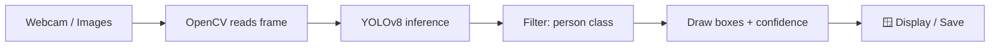

<div align="center">

#  Human Detection with YOLOv8

**Real-time and batch person detection powered by Ultralytics YOLOv8 and OpenCV**


</div>

---

##  About

This project uses **YOLOv8** object detection to find people in images and live webcam video. It includes scripts for:

-  **Live webcam detection** with the pretrained `yolov8n` model
-  **Live webcam inference** with a **custom-trained** model (`best.pt`)
-  **Batch image detection** that reads a folder of images and saves annotated results

Each detected person gets a green bounding box and a confidence score.

---

##  Features

| Feature | Description |
| --- | --- |
|  Real-time detection | Live webcam feed with instant bounding boxes |
|  Custom model | Use your own trained weights (`best.pt`) |
|  Batch processing | Process every image in `test_images/` automatically |
|  Clean overlays | Green boxes with `Person: 0.xx` confidence labels |
|  Safe handling | Skips unreadable images and reports camera errors |

---

##  Project Structure

```text
model/
├──  test_images/          # Input images for batch detection
|─  results/              # Annotated output images
├──  person_detection.py   # Live webcam detection (yolov8n.pt)
├──  live_camera.py        # Live webcam inference (custom model)
├──  onimage.py            # Batch detection on test_images/
├──  yolov8n.pt            # Pretrained YOLOv8 nano weights
├──  best.pt               # Custom trained weights
├──  best (1).pt           # Updated custom trained weights
├──  tic.py                # Bonus: console tic-tac-toe game
├──  p.py                  # Bonus: file reading demo
├──  data.txt              # Sample text used by p.py
└──  students.csv          # Sample CSV data
```

---

##  Getting Started

### 1. Clone the repository

```bash
git clone https://github.com/itsneo7/dip.git
cd dip
```

### 2. Install dependencies

```bash
pip install ultralytics opencv-python
```

>  A virtual environment is recommended:
> ```bash
> python -m venv venv
> venv\Scripts\activate
> ```

---

## Usage

###  Live detection with the pretrained model

```bash
python person_detection.py
```

Uses `yolov8n.pt` and detects only the **person** class. Press **`q`** to quit.

###  Live detection with the custom model

```bash
python live_camera.py
```

Runs `best (1).pt` on your webcam with a confidence threshold of `0.25`. Press **`q`** to quit.

###  Detect people in a folder of images

1. Put your images (`.jpg`, `.jpeg`, `.png`) in `test_images/`
2. Run:

```bash
python onimage.py
```

3. Find the annotated images in `results/`

---

##  How It Works



1. A frame is captured from the webcam, or an image is loaded from disk.
2. YOLOv8 predicts bounding boxes and confidence scores.
3. Results are filtered to class `0` (person).
4. Boxes and labels are drawn with OpenCV.
5. The frame is shown live, or the image is saved to `results/`.

---

#  Configuration

| Setting | File | Default | What it does |
| --- | --- | --- | --- |
| Model weights | all scripts | `yolov8n.pt` / `best (1).pt` | Swap in any YOLOv8 weights |
| Confidence | `live_camera.py` | `0.25` | Minimum score to show a detection |
| Camera index | live scripts | `0` | Change to `1`, `2`... for other cameras |
| Input folder | `onimage.py` | `test_images` | Folder to read images from |
| Output folder | `onimage.py` | `results` | Folder to save annotated images |

---

##  Bonus Scripts

- **`tic.py`** is a console tic-tac-toe game where you play **X** against a computer that wins, blocks, or takes the best open square.
- **`p.py`** shows three ways to read a text file: `read()`, `readline()` and `readlines()`.

---

##Troubleshooting

| Problem | Fix |
| --- | --- |
| `Could not access your local camera` | Close other apps using the camera, or change the camera index |
| `No images found in 'test_images'` | Add `.jpg`, `.jpeg` or `.png` files to the folder |
| `ModuleNotFoundError: ultralytics` | Run `pip install ultralytics` |
| Model file not found | Run scripts from the project root so the `.pt` files are found |

---

##  Built With

- [Ultralytics YOLOv8](https://github.com/ultralytics/ultralytics)
- [OpenCV](https://opencv.org/)
- [Python](https://www.python.org/)

---

<div align="center">
⭐ If you found this useful, consider giving the repo a star!

</div>
